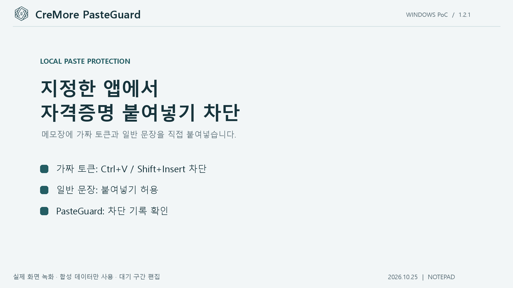

# CreMore PasteGuard

지정한 Windows 앱과 웹사이트에 민감한 형식의 문자열을 붙여넣을 때 차단하는 독립 실행형 Windows 앱입니다. 복사한 원문을 바꾸거나 클립보드를 비우지 않으며, 검사는 이 기기에서 이루어집니다.

이 README가 **사용 설명서**입니다. 앱의 **사용 설명서** 버튼으로 [GitHub의 최신 설명서](https://github.com/kigma00/CreMore-PasteGuard#readme)를 열 수 있습니다.

- [설정 후 실제 동작 원리](docs/how-it-works.md): Windows 앱과 웹에서 검사하고 차단하는 흐름, 기록과 예외 상황
- [관련 논문과 기존 기능 비교](docs/related-work.md): 유사 연구의 공통점, 차이점 및 평가 방향

## 메모장 붙여넣기 차단 PoC

[](https://github.com/kigma00/CreMore-PasteGuard/blob/main/media/pasteguard-notepad-poc.mp4)

[PoC 영상 보기](https://github.com/kigma00/CreMore-PasteGuard/blob/main/media/pasteguard-notepad-poc.mp4)

CreMore PasteGuard 1.2.1에서 `notepad.exe`를 대상으로 `ghg_[A-Za-z0-9]+` 패턴을 설정한 실제 Windows 화면 녹화입니다. 대기 구간을 줄이고 설명 자막을 추가했습니다. 영상에는 테스트용 가짜 문자열 `ghg_PASTEGUARDDEMO20261025ABC123`만 사용하며, 실제 자격증명은 포함하지 않습니다.

- 가짜 문자열의 `Ctrl+V`와 `Shift+Insert` 붙여넣기 차단
- 일반 문장 `PasteGuard demo: ordinary text is allowed.`의 붙여넣기 허용
- PasteGuard에서 대상 앱, 규칙, 차단 기록 확인

이 시연은 Windows 메모장의 두 붙여넣기 단축키를 검증합니다. 우클릭 메뉴, 직접 입력, 파일 업로드 등은 [보호 범위와 한계](#보호-범위와-한계)를 확인하세요.

## 실행 준비

- Windows 10/11과 .NET Framework 4.8이 필요합니다.
- 웹사이트를 보호하려면 Chrome 또는 Edge에 함께 제공되는 확장 프로그램을 설치합니다.
- 소스에서 실행하려면 아래 [빌드](#빌드)를 따라 빌드합니다. 기본 결과물은 `dist/PasteGuard/CreMore PasteGuard.exe`이며, [원하는 위치로 옮겨 실행](#실행-폴더를-옮겨도-되나요)할 수도 있습니다.
- 실행 파일과 `CreMore PasteGuard.exe.config`, `extension` 폴더를 함께 유지하세요. `.exe.config`는 화면 배율 지원에도 사용됩니다.

설치 프로그램이나 별도 서버는 필요하지 않습니다. 설정을 저장할 수 있는 폴더에서 실행하세요.

### 실행 폴더를 옮겨도 되나요?

**`dist` 아래에서 실행할 필요는 없습니다.** `dist/PasteGuard`는 빌드 스크립트가 결과물을 모으는 기본 경로입니다. 앱을 종료한 뒤 이 폴더 전체를 쓰기 권한이 있는 원하는 위치로 옮겨 실행하세요. 예를 들어 다음처럼 배치할 수 있습니다.

```text
C:\Apps\CreMore PasteGuard\
├─ CreMore PasteGuard.exe
├─ CreMore PasteGuard.exe.config
├─ extension\
├─ README.md
├─ docs\
└─ data\                     # 실행 후 생성되는 사용자 설정
```

| 파일과 폴더 | 옮길 때 확인할 내용 |
|---|---|
| `CreMore PasteGuard.exe` | 실행 파일 |
| `CreMore PasteGuard.exe.config` | 실행 파일과 같은 폴더에 유지. 화면 배율 설정 등에 사용 |
| `extension` | 웹 보호용 확장 프로그램. 앱의 확장 폴더 열기에서도 사용 |
| `README.md`, `docs` | 사용 설명서, 동작 원리 및 관련 연구 문서 |
| `data` | 기존 규칙과 연결 키를 유지하려면 함께 이동. 처음 실행하기 전에는 없어도 됨 |

설정은 실행 파일 옆에 저장되므로 해당 폴더에 쓰기 권한이 필요합니다. 기존 확장을 이전 경로에서 불러왔다면 Chrome과 Edge의 확장 관리 화면에서 새 위치의 `extension` 폴더로 다시 등록하고 연결 상태를 확인하세요. 연결 키는 Windows 사용자 계정으로 암호화되어 있으므로 다른 PC나 다른 Windows 계정으로 옮긴 경우 다시 연결해야 할 수 있습니다.

## 처음 사용하는 순서

1. **차단 규칙**에서 규칙 이름을 입력합니다. 처음 실행하면 저장된 규칙 없이 시작합니다. 추가 규칙은 **+ 규칙 추가**로 만듭니다.
2. **어디에서 막을까요?**에서 Slack, Notion, GitHub 웹사이트 버튼을 누르거나 대상 앱과 도메인을 직접 입력합니다.
3. **어떤 내용을 막을까요?**에서 검사 유형을 선택합니다. 직접 작성한 조건을 쓰려면 **직접 입력**을 선택합니다. 여러 형식을 함께 막으려면 **+ 패턴 추가**로 같은 규칙에 패턴을 더합니다.
4. 테스트 입력칸에 가짜 문자열을 직접 입력하고 **테스트**를 누릅니다. 이 규칙에서 편집 중인 전체 패턴 중 하나라도 일치하는지 확인합니다.
5. **규칙 사용**을 켜고 **규칙 저장**을 누른 뒤, 화면 위의 **보호 시작**을 누릅니다.

앱은 다시 실행할 때도 **Windows 보호가 꺼진 상태**로 시작합니다. 저장한 규칙을 확인한 뒤 보호를 시작하세요. 브라우저 보호에는 아래 연결 과정도 필요합니다.

### 설정하면 실제로 어떻게 동작하나요?

규칙을 저장하고 보호를 시작하면 **지정한 대상에, 등록한 패턴 중 하나라도 일치하는 문자열을 붙여넣는 경우**를 차단합니다. 같은 규칙 안에서는 대상 조건과 문자열 조건이 모두 맞아야 하며, 여러 패턴은 OR 조건으로 검사합니다. 여러 활성 규칙도 하나라도 조건에 해당하면 차단합니다. Windows 앱과 웹사이트에 같은 패턴 조건을 적용하며, 검사 준비 실패나 검사 한도 초과로 차단되는 경우도 있습니다.

| 경로 | 검사 시점 | 붙여넣기 차단 방법 |
|---|---|---|
| Windows 앱 | 클립보드 내용이 바뀌면 별도 작업 스레드에서 미리 검사 | `Ctrl+V` / `Shift+Insert` 때 현재 앱과 준비된 결과를 확인하여 단축키 전달 차단 |
| Chrome과 Edge 웹사이트 | 확장이 정책을 받은 뒤 일반 `paste` 이벤트가 발생할 때 | 해당 프레임의 도메인과 텍스트를 확인하여 붙여넣기 이벤트 취소 |

예를 들어 대상이 `Slack.exe`이고 패턴이 `PGTEST_[A-Z0-9]{16}`이면, `PGTEST_ABCD1234EFGH5678`을 **복사하는 것은 그대로 허용**하고 Slack 앱의 지원 단축키 붙여넣기는 막습니다. 다른 규칙이 없다면 메모장 붙여넣기는 허용됩니다. Slack 웹은 확장이 연결되어 있고 Slack 도메인이 규칙에 포함되어야 보호됩니다.

Windows에서는 앱의 **차단 기록**에 남고, 웹에서는 페이지 내 안내도 표시합니다. 붙여넣은 원문은 기록하거나 외부 서버에 보내지 않습니다. 검사는 문자열 형식에 대한 것으로 실제 발급된 토큰인지 확인하거나 Vault와 비교하지 않습니다.

현재 구현은 지원하는 입력 경로를 제어합니다. SaaS 저장 API나 모든 네트워크 전송을 가로채는 기능은 아니므로, 모든 입력과 저장 경로의 원천 차단을 보장하지 않습니다. 자세한 준비 조건과 제한은 [동작 원리](docs/how-it-works.md)에 정리했습니다.

### 누가 차단하나요? 앱인가요, Windows 설정인가요?

**Windows 경로에서는 실행 중인 PasteGuard가 차단 여부를 판단하고, Windows의 입력 훅 기능으로 전달을 중단합니다.** 규칙은 PasteGuard의 `data/policy.json`에 저장됩니다. 운영체제에 영구적인 DLP 정책을 설치하거나 별도 커널 드라이버나 Windows 서비스를 설치하는 방식은 아닙니다.

1. **보호 시작:** PasteGuard가 Windows에 클립보드 변경 알림과 키보드 감시 함수(훅)를 등록합니다. 훅은 입력이 대상 앱에 전달되기 전에 호출되는 함수입니다.
2. **복사:** 클립보드가 바뀌면 별도 작업 스레드에서 텍스트를 검사하고 결과를 준비합니다. 복사 내용을 지우지 않습니다.
3. **붙여넣기 단축키:** `Ctrl+V` 또는 `Shift+Insert`를 누르면 감시 함수가 현재 앞에 있는 앱과 준비된 결과를 확인합니다.
4. **판정:** 허용이면 입력 처리를 이어가고, 차단이면 전달 중단 결과를 Windows에 반환합니다. 그러면 대상 앱은 해당 단축키를 받지 못합니다.

```text
Ctrl+V → Windows 입력 처리 → PasteGuard의 키보드 훅
                                  ├─ 허용 → 대상 앱에 전달 → 붙여넣기
                                  └─ 차단 → 해당 키 입력 전달 중단
```

구현에서는 `SetWindowsHookEx`의 `WH_KEYBOARD_LL` 훅을 사용합니다. `KeyboardHook`이 차단 시 0이 아닌 값을 반환하고, 통과 시 `CallNextHookEx`로 다음 처리를 이어갑니다. 클립보드 변경은 `AddClipboardFormatListener`로 받습니다. **단축키 전달을 막는 방식이므로 Windows 앱의 우클릭 메뉴 붙여넣기나 클립보드 직접 읽기까지 차단하지 않습니다.**

웹에서는 **브라우저 확장**이 별도로 판단합니다. 정책이 준비된 페이지에서 `paste` 이벤트의 텍스트와 도메인을 검사하고, 차단 조건이면 `preventDefault()`와 `stopImmediatePropagation()`을 호출합니다. Slack과 Notion에 차단 코드를 설치하거나 Windows 앱이 매번 서버에 판정을 요청하는 구조는 아닙니다.

| 상태 | Windows 앱 보호 | 웹 보호 |
|---|---|---|
| 규칙만 저장하고 보호를 시작하지 않음 | 작동하지 않음 | 새로 연결한 확장에는 활성 정책이 전달되지 않음 |
| 보호 시작 후 확장이 활성 정책을 수신함 | 지원 단축키를 검사하고 차단 | 지원하는 페이지의 붙여넣기 이벤트를 검사하고 차단 |
| 보호 중지 | 훅을 해제하여 차단 중지 | 중지된 정책을 수신한 뒤 차단 중지 |
| PasteGuard 앱 종료 | Windows 차단 종료. 저장한 규칙 파일은 유지 | 확장이 마지막으로 받은 활성 정책으로 계속 차단할 수 있음 |
| 앱 재실행 | 저장된 규칙을 불러오지만 보호는 꺼진 상태 | 새 정책을 받기 전에는 이전 정책이 남아 있을 수 있음 |

따라서 Windows 보호에는 **PasteGuard 실행 + 보호 시작**이 필요합니다. 웹 보호를 확실히 해제하려면 중지된 정책을 동기화하거나 확장에서 **연결 해제**를 누르세요.

### 빈 입력칸과 저장된 값

새 규칙의 이름, 대상, 테스트 입력칸은 비어 있습니다. 빈 칸에 보이는 회색 안내는 입력 방법을 알려주는 **힌트(placeholder)**이며, 실제 값으로 저장되거나 검사에 사용되지 않습니다.

이미 저장한 규칙을 선택하면 저장된 이름, 대상, 검사 조건이 표시됩니다. 앱을 다시 실행해도 저장된 규칙과 브라우저 연결 키는 유지됩니다. 테스트 문자열은 규칙에 저장되지 않습니다.

검사 유형의 선택은 현재 선택한 패턴의 검사 조건을 바꿉니다. 예를 들어 **테스트 문자열** 유형을 선택하면 그 패턴이 `PGTEST_[A-Z0-9]{16}`으로 바뀌며, 같은 규칙의 다른 패턴은 유지됩니다. 입력칸의 회색 힌트와는 다릅니다.

### 차단할 대상 지정

빠른 추가 버튼은 기존 입력을 유지하면서 필요한 대상을 더합니다. 추가한 내용은 직접 수정할 수 있습니다.

| 빠른 추가 | Windows 앱 | 웹사이트 |
|---|---|---|
| Slack | `Slack.exe` | `slack.com`과 하위 도메인 |
| Notion | `Notion.exe` | `notion.so`, `notion.site`와 각각의 하위 도메인 |
| GitHub 웹사이트 | 없음 | `github.com`, `gist.github.com` |

직접 입력할 때는 다음 형식을 사용하세요.

- **앱 실행 파일명:** `Slack.exe`처럼 정확한 실행 파일명을 입력합니다. 폴더 경로는 넣지 않습니다. 대소문자는 구분하지 않습니다.
- **웹사이트 도메인:** `example.com`처럼 입력합니다. `https://`, 경로, 포트는 넣지 않습니다.
- 여러 대상은 쉼표로 구분합니다. 앱 또는 웹사이트 중 하나 이상이 필요합니다.
- `*.example.com`은 하위 도메인만 포함합니다. 기본 도메인도 보호하려면 `example.com, *.example.com`처럼 둘 다 추가합니다.

`chrome.exe`나 `msedge.exe`를 앱 대상으로 등록하면 해당 브라우저의 모든 탭에 Windows 규칙이 적용됩니다. 웹사이트별로 구분하려면 웹사이트 도메인과 확장 프로그램을 사용하세요.

### 검사 유형과 테스트

| 검사 유형 | 검사 조건 |
|---|---|
| 테스트 문자열 | `PGTEST_` 뒤 영문 대문자와 숫자 16자리 |
| GitHub PAT (classic) | `ghp_` 뒤 영문과 숫자 36자리 |
| 직접 입력 | 사용자가 작성한 지원 정규식 |

기본 유형도 실제로 적용되는 규칙입니다. **테스트 문자열** 유형은 동작 확인용이며, 실제 서비스의 토큰을 자동으로 찾아주는 유형이 아닙니다. GitHub 유형도 지정한 형식만 찾으며 토큰의 실제 유효성이나 모든 GitHub 토큰 종류를 확인하지 않습니다.

한 규칙에는 **검사 패턴을 여러 개 등록**할 수 있습니다. **+ 패턴 추가**로 빈 패턴을 더한 뒤 검사 유형을 고르거나 조건을 직접 입력합니다. 목록에서 패턴을 선택하면 그 패턴만 수정하며, **선택 패턴 삭제**로 제거할 수 있습니다. 규칙에는 유효한 패턴이 최소 하나 필요합니다. 편집 중인 패턴들은 **규칙 저장**을 눌러야 실제 보호에 적용됩니다. 기존에 저장한 패턴 하나짜리 규칙도 그대로 사용할 수 있습니다.

예를 들어 같은 `notepad.exe` 규칙에 `ghg_[A-Za-z0-9]+`와 `PGTEST_[A-Z0-9]{16}`을 등록하면, `ghg_DEMO123` 또는 `PGTEST_ABCD1234EFGH5678` 중 어느 문자열이든 차단 조건에 해당합니다. 두 형식이 한 문자열에 모두 있어야 하는 것은 아닙니다. 서로 다른 대상이나 사용 여부가 필요하면 규칙을 나누세요.

테스트 문자열은 자동으로 채워지지 않습니다. **테스트 문자열** 유형을 확인하려면 `PGTEST_ABCD1234EFGH5678` 같은 가짜 값을 직접 입력해 보세요. 실제 비밀번호나 토큰은 테스트에 사용하지 않는 편이 좋습니다.

**테스트**는 현재 편집 중인 규칙의 전체 패턴과 입력 문자열을 OR 조건으로 비교합니다. 목록에서 선택한 패턴 하나만 시험하는 기능은 아닙니다. 결과만으로 규칙이 저장되거나 보호가 시작되지는 않습니다. 실제 차단에는 저장된 규칙, 대상, 규칙 사용 여부와 보호 상태가 모두 적용됩니다. “차단 조건에 해당” 결과에는 패턴 일치뿐 아니라 검사 한도 초과도 포함될 수 있습니다.

### 저장, 수정, 삭제

- 수정한 내용은 **규칙 저장**을 눌러 적용합니다. 저장 버튼은 편집 영역 아래에 있습니다.
- 저장하지 않은 상태에서 다른 규칙으로 이동하거나 새 규칙을 만들거나 보호를 시작하거나 앱을 종료하면 저장 여부를 확인합니다.
- **규칙 삭제**는 확인 후 저장된 규칙을 삭제합니다.
- Windows 보호 중 규칙을 저장하면 Windows 검사에 반영됩니다. 브라우저는 다음 동기화 때 반영됩니다.

## 브라우저 연결: 3단계

1. **확장 설치:** Chrome의 `chrome://extensions` 또는 Edge의 `edge://extensions`를 엽니다. 개발자 모드를 켠 뒤 **압축해제된 확장 프로그램 로드**로 배포 폴더 안의 `extension`을 선택합니다. 앱의 **브라우저 연결 → 확장 폴더 열기**로 폴더를 찾을 수 있습니다.
2. **키로 연결:** 앱에서 **연결 키 복사**를 누릅니다. 브라우저의 CreMore PasteGuard 확장을 열어 키를 붙여넣고 **연결**을 누릅니다. 이 키는 앱과 확장을 연결하는 값이며 서비스 계정의 토큰이 아닙니다.
3. **페이지 확인:** 설치 전에 열었던 대상 웹페이지를 새로고침합니다. 확장 팝업에서 현재 페이지의 보호 상태와 규칙을 확인합니다. 앱에서 웹사이트 규칙을 저장하고 **보호 시작**도 눌러 주세요.

정책은 보통 약 30초마다, 확장 팝업이 열려 있으면 약 3초마다 동기화됩니다. 브라우저 절전 중에는 더 늦을 수 있습니다. 저장, 보호 시작, 보호 중지 후 확장의 **정책 새로고침**을 누르면 바로 확인할 수 있습니다.

앱이 닫히거나 연결이 끊겨도 확장은 **마지막으로 받은 정책을 유지**합니다. 웹 보호를 중지하려면 앱에서 보호를 중지한 뒤 확장의 정책을 새로고침하거나, 확장에서 **연결 해제**를 누르세요. 연결 해제는 확장에 저장된 정책도 지웁니다.

### 1.3.0으로 업데이트할 때

앱과 브라우저 확장을 **함께 1.3.0 이상으로 교체**하세요. 여러 패턴을 전달하기 위해 앱은 정책 형식 v2를 사용합니다. 새 확장은 기존 v1 정책과 새 v2 정책을 읽지만, 이전 확장은 v2를 읽지 못해 새 규칙이 웹에 적용되지 않습니다. 연결 실패 시 이전 정책이 남아 있을 수도 있습니다.

Chrome과 Edge의 확장 관리 화면에서 새 `extension` 폴더의 확장을 **새로고침**하고, 확장 팝업에서 **정책 새로고침**을 누른 뒤 보호할 웹페이지도 새로고침하세요. 새 정책을 받았는지 확인한 후 가짜 문자열로 검사하세요. Windows 앱만 교체한 것으로 웹 보호까지 업데이트되었다고 판단하지 마세요.

## 차단 기록과 저장 데이터

**차단 기록**은 이번 앱 실행 중의 최근 200건을 보여주는 읽기 전용 목록입니다. 시각, 대상 앱 또는 도메인, 규칙, 차단 사유만 표시하며, 붙여넣은 원문과 URL 경로는 기록하지 않습니다. 앱을 종료하면 기록은 사라집니다. 브라우저의 차단 기록 전달은 연결 상태에 따라 누락될 수 있습니다.

별도 외부 서버나 데이터베이스는 없습니다.

| 위치 | 저장 내용 |
|---|---|
| 실행 파일 옆 `data/policy.json` | 저장한 규칙 이름, 대상, 검사 패턴 목록, 사용 여부 |
| 실행 파일 옆 `data/pairing.key` | 현재 Windows 사용자 계정으로 암호화한 연결 키 |
| 확장 프로그램의 로컬 저장소 | 연결 키, 마지막 정책, 동기화 시각 |

확장은 붙여넣기 순간의 텍스트를 브라우저 안에서 검사하며, 원문을 Windows 앱이나 외부 서버로 전달하지 않습니다. 검사 중 원문은 프로세스 메모리에 잠시 존재하며 메모리의 완전한 제로화는 보장하지 않습니다. `data` 폴더와 연결 키를 공개 저장소나 배포 파일에 포함하지 마세요.

## 보호 범위와 한계

| 붙여넣기 경로 | 지원 범위 |
|---|---|
| 지정한 Windows 앱의 `Ctrl+V` / `Shift+Insert` | 저장된 규칙으로 검사하고 해당 키 전달을 차단 |
| 지정 웹사이트의 일반 입력란과 편집 영역 | 확장이 준비된 경우 키보드나 우클릭 붙여넣기 이벤트 취소 |
| Windows 앱의 우클릭이나 메뉴 붙여넣기, 직접 `WM_PASTE`, 별도 자동화 | 보호하지 않음 |
| 직접 입력, 드래그, 파일 업로드, 이미지, 앱의 클립보드 직접 읽기 | 보호 대상 아님 |
| 브라우저 내부 페이지, 확장 미설치, 초기 정책 로딩 전 | 보호 대상 아님 |
| 관리자 권한 앱, 다른 사용자 세션, 보안 데스크톱 | 보호를 보장하지 않음 |

이 앱은 정해진 붙여넣기 경로를 보호하는 프로토타입입니다. 모든 정보 유출 경로를 막는 강제 DLP 제품은 아닙니다. 다른 프로그램이 먼저 데이터를 읽거나 검사 직후 클립보드가 바뀌는 상황, 확장 제거나 앱 변조까지 방지하지는 않습니다.

지정된 대상에서 검사 준비가 실패하거나 검사 한도를 넘으면 보수적으로 차단할 수 있습니다. 이는 실제 자격증명이 발견됐다는 뜻은 아닙니다. 앱의 **보호 범위와 제한 보기**에서도 주요 제한을 확인할 수 있습니다.

## 직접 입력 패턴

지원하는 문법은 다음과 같습니다.

- 일반 문자, `[A-Z0-9]`, `[^ ]`
- `\d`, `\w`, `\s`, `\b`, `\n`, `\r`, `\t`, `\f`, `\v`
- 반복 `?`, `*`, `+`, `{n}`, `{n,m}`와 시작과 끝 조건 `^`, `$`

그룹, 정규식 내부의 OR(`|`), lookaround, 역참조, 플래그, 이스케이프하지 않은 `.`, `{n,}`는 지원하지 않습니다. 여러 형식을 OR 조건으로 검사하려면 같은 규칙의 패턴 목록에 각각 추가하세요. 검사 패턴은 대소문자를 구분하며 `\d`와 `\w` 등의 문자 범위는 ASCII 기준입니다.

패턴 하나는 최대 512자, 반복 횟수는 최대 256, 확장된 상태는 최대 2,048개입니다. 한 규칙에는 패턴을 최대 16개, 전체 정책에는 모든 규칙을 합쳐 최대 100개 등록할 수 있습니다. 검사 텍스트는 65,536 UTF-16 단위로 제한합니다. Windows에서는 한 규칙의 여러 패턴이 검사 작업 한도 8백만 회를 공유하며, 패턴을 추가해도 이 한도가 늘어나지 않습니다. 브라우저에서는 붙여넣기 전체 규칙이 8백만 회를 공유합니다. 규칙은 최대 100개, 한 규칙의 앱과 웹사이트 대상은 각각 128개까지 저장할 수 있습니다.

## 성능과 메모리

Windows 검사는 클립보드 변경 알림을 받아 실행하고, 붙여넣는 순간에는 준비된 결과를 확인합니다. 변경되지 않은 클립보드를 반복 검사하지 않으며 일반 키 입력은 빠르게 통과시킵니다. 대상 앱 조회용 버퍼도 재사용합니다.

검사 엔진은 패턴과 작업 배열을 재사용합니다. 작업 배열은 Windows 검사 스레드당, 브라우저 검사 컨텍스트당 각각 최대 약 4 KiB이며 원문을 보관하지 않습니다. 브라우저 정책은 저장된 규칙이 바뀔 때만 다시 변환하고, 동일한 정책을 반복해서 저장하거나 탭에 전송하지 않습니다. 기존 검사 한도와 한도 초과 시 차단 동작은 유지합니다.

합성 문자열로 측정하려면 `powershell -ExecutionPolicy Bypass -File .\perf.ps1`을 실행하세요. `-Native`를 추가하면 현재 앞에 있는 앱의 실행 파일명 조회 비용도 측정합니다. 이 측정은 클립보드를 읽거나 키 입력을 보내지 않습니다. 수치는 PC와 규칙에 따라 달라지며 앱 전체 메모리 또는 실제 서비스의 붙여넣기 지연을 뜻하지 않습니다.

앱을 새 버전으로 교체한 뒤 브라우저 확장도 확장 관리 화면에서 **새로고침**하고 대상 웹페이지를 다시 여세요.

## 빌드

저장소를 받은 뒤 프로젝트 폴더에서 PowerShell로 실행합니다.

```powershell
powershell -ExecutionPolicy Bypass -File .\build.ps1
```

Windows의 .NET Framework 컴파일러를 사용하며 NuGet 패키지 설치는 필요하지 않습니다. 빌드 결과는 다음과 같습니다.

- 기본 출력 폴더: `dist/PasteGuard/` — 필수 설치 및 실행 위치가 아님
- 배포 ZIP: `dist/CreMore-PasteGuard-windows.zip`

빌드 후 [실행 폴더 이동 안내](#실행-폴더를-옮겨도-되나요)에 따라 원하는 위치에서 사용할 수 있습니다. 배포 ZIP에는 사용자 설정과 연결 키가 포함되지 않습니다. 실행 파일은 서명되지 않은 개발용 파일이므로 조직의 실행 정책에 따라 차단될 수 있습니다.

주요 소스는 `Program.cs`(앱 상태와 저장), `Ui.cs`(화면과 사용 설명서 연결), `RulePresets.cs`(기본 유형과 대상), `Core.cs`(정책과 패턴 검사), `WindowsGuard.cs`(Windows 보호), `Bridge.cs`(로컬 연결), `extension/`(브라우저 확장)입니다. 앱과 확장은 `127.0.0.1:17843`에서 연결 키를 확인하며 통신합니다.

앱과 확장 아이콘에는 프로젝트 사용자가 제공한 CreMore 로고를 사용합니다.

## 테스트

기본 테스트에는 Node.js가 필요합니다. 프로젝트 폴더에서 실행합니다.

```powershell
powershell -ExecutionPolicy Bypass -File .\test.ps1
powershell -ExecutionPolicy Bypass -File .\test.ps1 -Ui
powershell -ExecutionPolicy Bypass -File .\tests\run-layout.ps1
```

| 옵션 | 추가 검사 |
|---|---|
| 없음 | 정책, 패턴, 기본 유형, 브라우저 확장 단위 테스트 |
| `-Ui` | 별도 임시 설정 폴더에서 규칙 편집, 저장, 선택, 대상 추가 확인. 실제 클립보드나 키보드 훅 사용 안 함 |
| `-Bridge` | 로컬 연결 인증 검사. 포트 충돌을 피하려면 앱을 종료한 뒤 실행 |
| `-NativeLifecycle` | 실제 Windows 키보드 훅의 시작, 중지, 재시작, 해제 검사 |

`tests/run-layout.ps1`은 현재 디스플레이 배율의 기본 크기와 최소 창 크기에서 버튼, 설명, 입력란의 글자 잘림을 검사합니다. 별도 임시 설정 폴더에서 실행하며 실제 규칙이나 클립보드를 변경하지 않습니다.

이 테스트만으로 Slack과 Notion 등 실제 서비스의 모든 입력 경로가 검증되지는 않습니다. `tests/NativeHarness.cs`에는 별도 붙여넣기 검증용 모드도 있으므로, 이를 실행할 때는 해당 테스트의 클립보드 보존 조건을 먼저 확인하세요.
