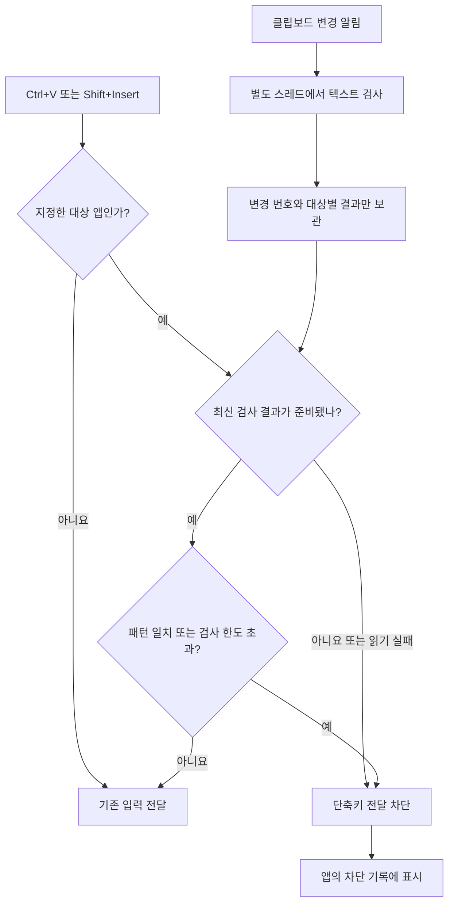
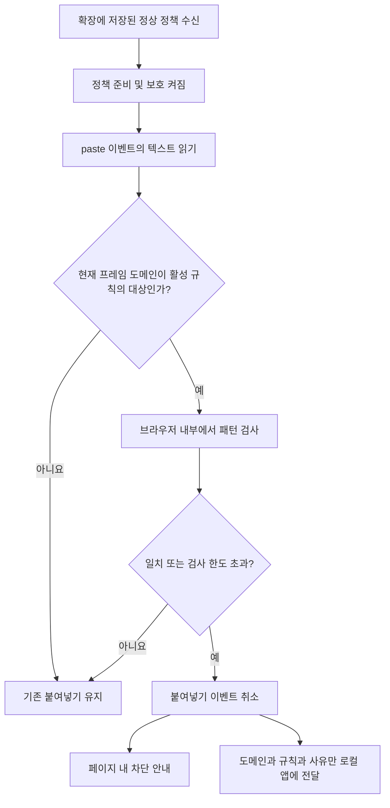

# CreMore PasteGuard 동작 원리

설명 기준: 1.2.1, 2026-10-25. [사용 설명서로 돌아가기](../README.md)

PasteGuard는 **사용자가 지정한 대상에서 민감한 형식의 문자열을 붙여넣는 동작을 제한**합니다. 복사한 내용을 지우지 않고, 일반적인 작업에 미치는 영향을 줄이도록 대상과 문자열 조건을 함께 확인합니다. Windows 앱과 웹사이트는 입력을 받는 방식이 달라 서로 다른 경로로 처리합니다.

## 1. 규칙 저장과 보호 시작

1. 규칙 이름, 대상 앱 실행 파일명 또는 웹 도메인, 검사 패턴과 사용 여부를 입력합니다.
2. **규칙 저장**을 누르면 입력 형식과 지원 패턴 문법을 검증합니다. 유효한 규칙만 실행 파일 옆 `data/policy.json`에 저장됩니다. 저장 전 편집은 보호 정책에 반영되지 않습니다.
3. **보호 시작**을 누르면 Windows 감시가 시작됩니다. 이미 보호 중이면 저장한 규칙이 Windows 감시에 반영됩니다.
4. 웹에서는 별도로 확장 설치, 연결 키 등록, 정책 수신이 필요합니다. 설치 전에 열어둔 대상 웹페이지는 새로고침합니다.

앱은 재실행 시 보호가 꺼진 상태로 시작합니다. 앱 실행 자체나 규칙 저장만으로 Windows 보호가 시작되지는 않습니다.

일반적인 차단 조건은 `보호 켜짐 AND 활성 규칙 AND 대상 일치 AND 문자열 패턴 일치`입니다. 여러 활성 규칙은 하나라도 조건에 해당하면 차단하며, 검사 한도 초과 등으로 보수적으로 차단하는 경우는 아래에서 따로 설명합니다.

## 2. Windows 앱: 미리 검사하고 단축키 전달을 결정

- 활성 Windows 대상이 있으면 보호 시작 및 클립보드 변경 시 텍스트를 읽어 검사합니다. **대상 앱에 붙여넣기 전에도 검사가 수행**되지만 복사 동작을 취소하거나 클립보드를 비우지는 않습니다.
- 검사는 별도 작업 스레드에서 수행합니다. 단축키 처리 중에는 원문 전체를 다시 검사하거나 웹·서버 응답을 기다리지 않습니다.
- 준비된 결과에는 클립보드 변경 번호, 대상 앱별 일치 규칙 이름과 실패 상태가 들어갑니다. 원문은 이 결과 캐시에 넣지 않습니다.
- 붙여넣기 단축키가 발생하면 현재 앞에 있는 창의 프로세스 실행 파일명을 조회합니다. 지정한 앱이면 최신 결과를 보고 키 전달을 막거나 허용합니다. 검사 중 클립보드가 바뀌었으면 이전 결과를 재사용하지 않습니다.
- 같은 클립보드의 완료된 검사는 반복하지 않습니다. 읽기 실패처럼 재시도 가능한 상태는 다시 검사합니다.
- 차단 결과는 UI에 비동기로 전달됩니다. Windows 경로는 앱 내 차단 기록에 표시하며 별도 Windows 알림 토스트를 띄우지는 않습니다.

`Slack.exe`만 대상으로 등록한 규칙은 메모장에는 적용되지 않습니다. 반대로 `chrome.exe`를 Windows 대상으로 등록하면 그 브라우저의 모든 탭이 실행 파일명 기준의 대상이 됩니다. 웹사이트별 구분에는 확장의 도메인 규칙을 사용하세요.

## 3. 웹사이트: 붙여넣기 이벤트 안에서 검사

- 확장은 HTTP/HTTPS 페이지에서 준비되며, 각 프레임의 URL에서 도메인을 확인합니다. 최상위 페이지와 iframe의 도메인이 다르면 해당 프레임의 도메인으로 판정합니다.
- 정책이 준비되고 활성화된 상태에서 일반 `paste` 이벤트가 발생하면 `text/plain`을 읽은 뒤 도메인과 규칙을 비교합니다. 즉, 현재 구현은 도메인 판정보다 먼저 이벤트의 텍스트를 읽습니다.
- 일치하거나 검사 작업 한도를 넘으면 `preventDefault()`와 `stopImmediatePropagation()`으로 기본 붙여넣기와 이후 이벤트 전달을 취소합니다. 검사는 브라우저 안에서 동기적으로 끝나며 Windows 앱의 응답을 기다리지 않습니다.
- 페이지에는 약 4초간 차단 안내를 표시합니다. 기록 전달이 실패해도 이미 결정된 차단은 유지됩니다.

이것은 **지원하는 입력 이벤트를 취소하는 기능**입니다. Slack·Notion의 저장 API나 전송 버튼을 가로채지 않으며, 먼저 원문을 읽은 다른 처리기나 별도 Clipboard API 접근까지 되돌리지는 않습니다.

## 4. 허용·차단·보호하지 않는 경우

| 상황 | 현재 동작 |
|---|---|
| 대상과 패턴이 모두 일치 | 지원 경로의 붙여넣기 차단 |
| 대상이 아니거나 해당 활성 규칙의 패턴과 불일치 | 허용. 다른 규칙이 적용될 수 있음 |
| Windows 대상 앱에서 검사 결과가 없거나 오래됨, 읽기 실패 | 보수적으로 차단. 준비가 끝나면 다시 붙여넣을 수 있음 |
| 지정 대상에서 텍스트 길이·검사 작업 한도 초과 | 보수적으로 차단. 실제 자격증명 발견을 뜻하지 않음 |
| Windows에서 현재 프로세스 조회 실패 | 해당 훅은 입력을 통과시킴 |
| 웹 확장 미설치, 정책 초기 로딩 전, 이벤트에 clipboardData 없음 | 해당 확장의 붙여넣기 검사 미적용 |
| Windows 앱의 우클릭·메뉴 붙여넣기, 직접 입력, 드래그, 파일 업로드 | 현재 Windows 단축키 보호 범위 밖 |
| 다른 앱의 클립보드 직접 읽기 | 이 앱이 접근 자체를 차단하지 않음 |

웹은 확장이 준비된 일반 입력란·편집 영역의 우클릭 붙여넣기도 `paste` 이벤트로 처리할 수 있습니다. 모든 앱·권한 수준·입력 경로에서 강제 차단한다고 해석해서는 안 됩니다.

## 5. Windows 앱과 확장이 주고받는 정보

앱의 로컬 연결은 `127.0.0.1:17843`에서만 수신합니다. 확장은 연결 키를 확인받아 규칙과 보호 상태를 가져오고, 차단 시 도메인·규칙 이름·사유를 보냅니다. 원문이나 전체 URL 경로는 이 연결로 보내지 않습니다.

- 정책 동기화: 보통 30초마다. 확장 팝업 또는 설정 화면이 보이면 약 3초마다 확인합니다. 브라우저 절전·작업 스케줄링에 따라 늦어질 수 있습니다.
- 저장과 중지: Windows에는 바로 반영되고 웹에는 다음 정책 동기화 때 적용됩니다. 빠르게 반영하려면 확장의 **정책 새로고침**을 누릅니다.
- 앱 종료·연결 실패: 웹은 마지막 정상 정책을 유지합니다. Windows 앱을 닫는 것만으로 이미 켜져 있던 웹 보호가 즉시 꺼지지는 않습니다.
- 웹 보호 해제: 중지된 정책을 동기화하거나 확장의 **연결 해제**를 사용합니다.

이 독립 앱은 CreMore 서버·GitHub API·Vault에 원문을 보내거나 조회하지 않습니다. 형식 일치 여부를 검사하므로 실제 토큰 유효성이나 Vault 관리 여부를 판정하지 않습니다.

## 6. 기록과 원문 취급

차단 기록은 앱 실행 중 메모리에 최근 200건만 유지합니다. 시각·대상·규칙·사유가 표시되고 앱 종료 시 사라집니다. 브라우저 기록 전송은 10초당 최대 20회로 제한되므로 연속 차단이나 연결 실패 시 일부 기록이 빠질 수 있습니다.

원문은 검사 중 메모리에 잠시 존재합니다. 원문을 정책 파일·로그·외부 서버에 저장하지 않지만 메모리의 완전한 삭제를 보장하지는 않습니다. 검사 엔진의 재사용 배열에는 상태 플래그만 보관합니다.

## 7. 직접 확인할 예제

1. 새 규칙에 `Slack.exe`와 `PGTEST_[A-Z0-9]{16}`을 설정하고 저장 후 보호를 시작합니다.
2. 가짜 문자열 `PGTEST_ABCD1234EFGH5678`을 복사합니다.
3. Slack 앱에서 `Ctrl+V`로 붙여넣어 차단 기록을 확인합니다. 처음에는 검사 준비 때문에 잠깐 차단될 수도 있습니다.
4. 다른 규칙이 없는 메모장에서는 같은 문자열이 붙여넣어지는지 확인합니다.
5. 웹은 `slack.com, *.slack.com`을 추가하고 확장을 연결·동기화한 뒤 새로고침한 Slack 웹페이지에서 확인합니다.

이 예제는 사용자가 수행할 검증 절차이며 모든 Slack 버전과 환경에서 이미 검증됐다는 의미는 아닙니다. 실제 자격증명 대신 가짜 문자열을 사용하세요.

## 구현 위치

| 역할 | 코드 |
|---|---|
| 저장, 보호 시작·중지, 정책 스냅샷, 기록 | [Program.cs](https://github.com/kigma00/CreMore-PasteGuard/blob/main/Program.cs): `SaveRule`, `SetRunning`, `PublishBrowserPolicy`, `AddEvent` |
| Windows 변경 감시, 사전 검사, 단축키 차단 | [WindowsGuard.cs](https://github.com/kigma00/CreMore-PasteGuard/blob/main/WindowsGuard.cs): `ClipboardLoop`, `KeyboardHook`, `ForegroundProcess` |
| 지원 패턴과 검사 한도 | [Core.cs](https://github.com/kigma00/CreMore-PasteGuard/blob/main/Core.cs): `PolicyEngine.MatchText` |
| 확장 연결 | [Bridge.cs](https://github.com/kigma00/CreMore-PasteGuard/blob/main/Bridge.cs), [background.js](https://github.com/kigma00/CreMore-PasteGuard/blob/main/extension/background.js) |
| 웹 이벤트 취소, 페이지 안내 | [content.js](https://github.com/kigma00/CreMore-PasteGuard/blob/main/extension/content.js): `onPaste`, `notifyBlocked` |
| 웹 도메인 선택과 패턴 검사 | [matcher.js](https://github.com/kigma00/CreMore-PasteGuard/blob/main/extension/matcher.js): `preparePolicy`, `decidePaste`, `evaluate` |
